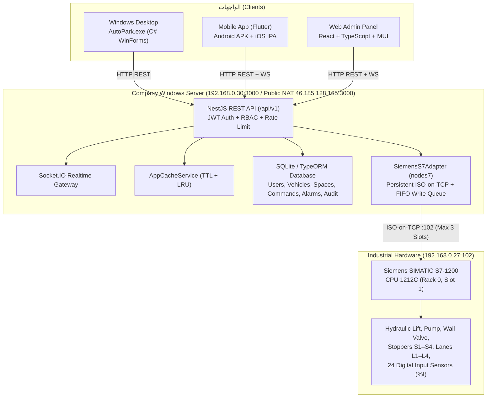

# AutoPark — الدليل التقني الشامل وخريطة البرنامج الكاملة (جاهز للمشاركة مع ChatGPT)

---

## 1. ملخص تنفيذي للبرنامج (Executive Summary)

**AutoPark** هو نظام صناعي متكامل لإدارة وتشغيل **موقف سيارات آلي ذكي (Automated Smart Parking System)** لشركة **TECHNO Electrical.Jo**، يتحكم فعلياً في مصعد هيدروليكي متعدد المسارات والطوابق مربوط بمتحكم **Siemens SIMATIC S7-1200 (CPU 1212C DC/DC/DC)**.

- **السعة الفعلية للماكنة:** **12 مصفاً** موزعة على **4 مسارات (Lanes 1–4) × 3 طوابق (P1 السفلي، P2 الأوسط، P3 العلوي)** بترميز `L11` إلى `L43`.
- **البنية البرمجية (4 مكونات متكاملة):**
  1. **الخادم الخلفي (Backend API & PLC Engine):** مبني بـ **NestJS (TypeScript)** + مكتبة **`nodes7`** للاتصال المباشر مع S7-1200 عبر بروتوكول ISO-on-TCP (`Port 102`) + قاعدة بيانات **SQLite / TypeORM** + بث حي **Socket.IO** + نظام كاش داخلي (`AppCacheService`).
  2. **تطبيق سطح المكتب (Windows Desktop):** مبني بـ **C# (.NET Framework 4.x / WinForms)** بدون تبعيات خارجية ثقيلة، يُبنى كملف تنفيذي واحد **`AutoPark.exe`**.
  3. **تطبيق الهاتف (Mobile App — Android & iOS):** مبني بـ **Flutter (Dart)** مع **Riverpod + Dio + GoRouter**، يُبنى تلقائياً عبر **GitHub Actions** كملفي **`AutoPark.apk`** (أندرويد) و **`AutoPark-iOS.ipa`** (آيفون).
  4. **لوحة تحكم الويب (Web Admin Panel):** مبنية بـ **React + TypeScript + Material UI (MUI) + Vite**.

---

## 2. البنية المعمارية وخريطة النظام (System Architecture)



### عناوين الشبكة والمستودع
- **سيرفر الشركة (LAN / VPN):** `http://192.168.0.30:3000/api/v1`
- **العنوان العام للموبايل (Public NAT):** `http://46.185.128.165:3000/api/v1`
- **المتحكم الصناعي (Siemens S7-1200):** `192.168.0.27:102` (Rack `0`, Slot `1`)
- **مستودع GitHub:** https://github.com/mohsafadi83-cell/AutoPark
- **صفحة الإصدارات الجاهزة (`AutoPark.exe` / `AutoPark.apk` / `AutoPark-iOS.ipa`):** https://github.com/mohsafadi83-cell/AutoPark/releases/tag/latest

---

## 3. خريطة ملفات المشروع (Codebase Map)

| المسار | اللغة / التقنية | الوظيفة الأساسية |
| :--- | :--- | :--- |
| `backend/src/modules/industrial/adapters/siemens-s7.adapter.ts` | TypeScript (`nodes7`) | قلب الاتصال مع الـ PLC: قراءة `IB0..3`, `QB0..3`, `DB1`, `DB2`, `%M`، طابور كتابة FIFO، تسلسل الأوتوماتيكي من مرحلتين، التحكم اليدوي، وحماية الأمان. |
| `backend/src/modules/industrial/integration-settings.ts` | TypeScript | الخريطة الكاملة والمعتمدة لجميع عناوين الـ PLC (`DEFAULT_VERIFIED_S7_TAG_MAP`: أكثر من 135 تاج موثّق). |
| `backend/src/modules/industrial/adapters/siemens-s7.dryrun.spec.ts` | Jest Unit Tests | اختبارات محاكاة آمنة (Dry-Run) بدون حركة فيزيائية للتحقق من جميع التسلسلات وحمايات الأمان. |
| `backend/src/modules/parking/parking.module.ts` | NestJS / TypeORM | إدارة المصفات (`L11–L43`)، طلبات الإيداع والاسترجاع (`targetSpaceNumber`)، وحالة الطلبات. |
| `backend/src/common/cache.module.ts` | TypeScript | خدمة كاش مركزية `AppCacheService` مع TTL ومنع تكرار الاستعلامات وإحصائيات حية. |
| `src/Pages.cs` | C# (WinForms) | لوحة التحكم الرئيسية، خريطة الـ 12 مصف، نافذة الصف/الاسترجاع التلقائي (`ParkVehicleDialog`) مع زر إرجاع المصعد للطابق الأرضي (P1). |
| `src/IndustrialPages.cs` | C# (WinForms) | شاشة **الحساسات (`SensorMonitorPage`)**، شاشة **التحكم اليدوي والصيانة (`ManualMaintenancePage`)**، ونافذة **استعادة الطوارئ (`EmergencyRecoveryDialog`)**. |
| `src/SystemCheckPage.cs` | C# (WinForms) | شاشة **فحص النظام الشامل**: عرض حي لمداخل `I0.0–I3.7` ومخارج `Q0.0–Q3.7` وجميع بتات `DB1` (25 بت) وجميع سجلات `DB2` (43 سجل). |
| `src/AppSettings.cs` | C# (WinForms) | إدارة الإعدادات، الاتصال بالخادم الخلفي (`SendManualControl`, `SendPlcWrite`, `SendPlcWriteBool`, `PullSensorsFromBackend`). |
| `src/ClassicControlSimulatorPage.cs` | C# (WinForms) | محاكي دوائر التحكم الكلاسيكي (DOL، عكس حركة، ستار-دلتا، المصعد الهيدروليكي) مع مرآة حية للـ PLC. |
| `src/VncClient.cs` | C# (WinForms) | وحدة التحكم المباشر (Direct HMI Console) للوصول السريع لمصفوفة الـ 12 مصف بدون VNC. |
| `mobile/lib/core/network/api_client.dart` | Dart / Flutter | عميل API للموبايل + دوال `requestPark` / `requestRetrieve` / `dispatchAutoPlcStep1` / `returnLiftToGroundFloor`. |
| `mobile/lib/features/map/parking_map_screen.dart` | Dart / Flutter | خريطة المواقف في الموبايل: اختيار مصف محدد (`L11–L43`) وتحريك المصعد مباشرة + زر إرجاع المصعد للطابق الأرضي (P1). |
| `mobile/lib/features/monitoring/monitoring_screen.dart` | Dart / Flutter | مراقبة حالة الـ PLC والحساسات والإنذارات حياً من الهاتف. |
| `admin/src/pages/ParkingPage.tsx` | React / TypeScript | خريطة المواقف وإدارة الطلبات في لوحة تحكم الويب. |
| `.github/workflows/build-mobile.yml` | GitHub Actions | بناء تلقائي لنسختي **`AutoPark.apk`** (Ubuntu) و **`AutoPark-iOS.ipa`** (macOS) ورفعهما تلقائياً للـ `latest` Release. |
| `UPDATE_COMPANY_SERVER.bat` | Windows Batch | سكريبت تحديث سيرفر الشركة (`192.168.0.30`) تلقائياً من GitHub وإعادة بناء وتشغيل الـ Backend. |

---

## 4. خريطة عناوين الـ PLC المعتمدة (Siemens S7-1200 — TIA Portal)

### أ) المداخل الرقمية الفيزيائية — `Inputs [24]` (`%I0.0–%I3.7`)
| العنوان | اسم التاج في TIA Portal | الوظيفة |
| :--- | :--- | :--- |
| `I0.0` | `MAIN_PF_1` | مراقبة الفاز / الطاقة الرئيسية |
| `I0.1` | `PCELL_IN_1` | حساس الفوتوسيل الداخلي |
| `I0.2` | `out_photocell` | حساس الفوتوسيل الخارجي |
| `I0.3` | `PUMP_OL` | أوفرلود المضخة الهيدروليكية |
| `I0.4` | `COMP_OL` | أوفرلود الضاغط الهوائي |
| `I0.5` / `I0.6` | `SPARE_IN2` / `SPARE_IN3` | مداخل احتياطية |
| `I0.7` | `EMRGENCY` | مفتاح إيقاف الطوارئ الفيزيائي |
| `I2.0` – `I2.3` | `PL1_MG_PROT` – `PL4_MG_PROT` | الحماية الميكانيكية للمسارات 1–4 (`False` = سليم، `True` = عطل) |
| `I2.4` – `I2.7` | `PL1_LS_BTM` – `PL4_LS_BTM` | حساسات الحد السفلي (الطابق الأرضي `P1`) |
| `I3.0` – `I3.3` | `PL1_LS_TOP` – `PL4_LS_TOP` | حساسات الحد العلوي (الطابق الثالث `P3`) |
| `I3.4` – `I3.7` | `PL1_LS_MID` – `PL4_LS_MID` | حساسات الحد الأوسط (الطابق الثاني `P2`) |

### ب) كتلة البيانات الأولى — `ParkIO_Data [DB1]` (25 بت: `DB1,X0.0` – `DB1,X3.0`)
- **حالات النظام والأوضاع:** `FAULT_DB (0.0)`, `EMG_DB (0.1)`, `PFAIL_DB (0.2)`, `Auto_DB (0.3)`, `AutoOK_DB (0.4)`, `Manual_DB (0.5)`, `ManualOK_DB (0.6)`, `PCELL_in (0.7)`, `PCELL_out (1.0)`.
- **أزرار التحكم اليدوي:** `Man_Pump (1.1)`, `Man_Wall (1.2)`, `Man_Up (1.3)`, `Man_Down (1.4)`, `Man_Cutoff (1.5)`, `Man_L1..L4 (1.6–2.1)`, `Man_LQ1..LQ4 Stoppers (2.2–2.5)`.
- **أعلام مساعدة:** `User_Logoff (2.6)`, `Sim Manual (2.7)`, `wall_sim_mun (3.0)`.

### ج) كتلة البيانات الثانية — `ParkDB [DB2]` (جميع الـ 43 سجل: صفوف 2–44، من `0.0` حتى `10.3`)
- **إشغال المصفات الـ 12 (`L11`–`L43`):** `DB2,X0.0` حتى `DB2,X1.3`.
- **حالة المسار والفوتوسيل:** `LANE_FULL (1.4)`, `LANE_OK (1.5)`, `LANE_VERIFY (1.6)`, `PCELLF..PCELL_Num (1.7–2.4)`, `Park_IN_START (2.5)`, `Park_OUT_START (2.6)`.
- **أرقام الهدف للتشغيل التلقائي:**
  - **`Lane_Number` (Byte @ 3.0):** **`DB2,B3`** (القيمة `1..4`)
  - **`Level_Number` (Byte @ 4.0):** **`DB2,B4`** (القيمة `1..3`: `1=P1`, `2=P2`, `3=P3`)
- **تسلسل المرحلتين (2-Step Handshake):**
  - `Park_IN_Step1 (5.0)`, `Park_IN_Step2 (5.1)`, `Park_OUT_Step_1 (5.2)`, `Park_OUT_Step2 (5.3)`
  - `Park_Step1_Ready (5.4)`, `Park_Step1_Done (5.5)`, `Park_Step2_Ready (5.6)`, `Park_Step2_Done (5.7)`
  - `Park_Step1_OK (6.0)`, `Park_Step2_OK (6.1)`, `Park_Auto_NoProgress (6.2)`
  - **`Park_IN (6.3)`** / **`Park_OUT (6.4)`**
- **الإنذارات والصيانة:** **`Alarm Word (UInt @ 8.0 → DB2,W8)`**, `Reset (10.0)`, `Period_Maintanence (10.1)`, `New_Maintanence_period (10.2)`, `Wall_valve (10.3)`.

### د) الذاكرة الداخلية (`%M`)
- `M0.3`: `manual_action` (يُفعّل مع Stoppers `S1–S4` و Lanes `L1–L4`)
- `M0.4`: `Accept_action_manual` (يُفعّل لحظياً فقط مع Lanes `L1–L4`)
- `M0.5`: `Reset`
- `M3.3`: `Obstacle_exist` | `M3.4–M3.7`: `Lane1..4_check_location`
- **`M10.0`**: `Park_IN_Step1_Start` (بدء المرحلة 1 — رفع/تجهيز المصعد)
- **`M10.1`**: `Park_IN_Step2_Start` (بدء المرحلة 2 — إرجاع المصعد للطابق الأرضي `P1`)
- `M50.0–M50.5` / `MW50`: إنذارات الطوارئ والأوفرلود والتموضع و `Alarm Section`
- `M200.0`: `Allow wall`

---

## 5. آلية عمل الكود (Workflows & Safety Logic)

### 1. التشغيل التلقائي من مرحلتين (Automatic 2-Step Park & Retrieve)
1. **المرحلة 1 (اختيار المصف `L{lane}{level}` وتحريك المصعد):**
   - فحص الأمان المسبق (`EmergencyStop = OFF`، `MG_PROT = False`).
   - تصفير أي بت مانيول عالق (`DB1,X1.1–X1.5`, `DB1,X0.5`, `DB1,X2.6`, `DB1,X2.7`, `M0.3`, `M0.4`) وتفعيل **`Auto_DB (DB1,X0.3 = true)`**.
   - كتابة **`DB2,B3 = Lane (1..4)`** و **`DB2,B4 = Level (1..3)`**.
   - في حالة الإيداع (`PARK`): تفعيل `Lane{n}_check_location (M3.4–M3.7)` + `Park_IN (DB2,X6.3 = true)` + `Park_OUT = false`.
   - في حالة الاسترجاع (`RETRIEVE`): تفعيل `Park_OUT (DB2,X6.4 = true)` + `Park_IN = false`.
   - بعد `250ms` لتثبيت القيم في دورة الـ PLC: تنفيذ **`SetBit(M10.0)`** + **`ResetBit(DB2,X5.4)`**.
   - مراقبة حساس الطابق **و** إشارات الـ PLC (`Step1_Done` / `Step2_Ready` / `Step2_Done`) بمهلة 60 دورة مع تحديث دوري ومعالجة تلقائية آمنة (Safe Reset `DB2,X10.0` + `M0.5`) فقط إذا كان الوضع آمناً (`Alarm Word = 0` بدون طوارئ أو عائق).
2. **المرحلة 2 (إرجاع المصعد للطابق الأرضي — الوضع الافتراضي `P1`):**
   - بعد صف السيارة في مكانها، يضغط المستخدم زر **«⬇ إرجاع المصعد للطابق الأرضي (P1)»** (في الكمبيوتر أو الموبايل)، فيرسل:
     `Auto_DB (DB1,X0.3) = true` → **`SetBit(M10.1 Park_IN_Step2_Start)`** → **`ResetBit(DB2,X5.6 Park_Step2_Ready)`** → `RETURN_PARK`.

### 2. وضع الصيانة والتحكم اليدوي (Manual Maintenance Mode)
- **الصفوف 1–3 (تبديل Toggle ON/OFF):** `Pump`, `UP`, `DOWN`, `Wall`, `Cutoff`, `Allow Wall (M200.0)`, `Stopper S1–S4` (مع تفعيل `M0.3` للـ Stoppers بدون `M0.4`).
- **الصف السفلي 4 (لحظي Momentary Press & Hold):** `Lane L1–L4` — تفعّل بت المسار + `M0.3` + **`Accept_action_manual (M0.4)`** أثناء الضغط وتفصل فوراً عند الإفلات.
- **حماية هيدروليكية صارمة (Interlocks):**
  - تشغيل `UP` يفصل `DOWN` و `Cutoff` تلقائياً؛ تشغيل `DOWN` يفصل `UP` و `Pump` و `Cutoff`.
  - **حظر مطلق للكتابة المباشرة على المخارج الفيزيائية `%Q`** (يرجع `HTTP 403 REJECTED`).
  - جميع الكتابات إلى `nodes7` تمر عبر طابور تسلسلي **FIFO (`writeChain`)** على اتصال TCP واحد مستمر لتفادي استنفاد حد S7-1200 (3 اتصالات متوازية كحد أقصى)، مع تحويل تلقائي لأي عنوان بت إلى `boolean` حقيقي (`true`/`false`).

---

## 6. ملخص جاهز للنسخ واللصق في ChatGPT (Copy-Paste Prompt)

> **انسخ النص التالي وألصقه مباشرة في ChatGPT لتعريفه بالمشروع بالكامل:**
>
> ```text
> I have an industrial Automated Smart Parking System called "AutoPark" (TECHNO Electrical.Jo) controlling a Siemens SIMATIC S7-1200 CPU 1212C PLC (192.168.0.27:102, Rack 0, Slot 1) with 12 parking bays (4 Lanes × 3 Floors: L11..L43, where P1=Bottom, P2=Mid, P3=Top).
>
> Architecture:
> - Backend: NestJS (TypeScript) + nodes7 + SQLite/TypeORM + Socket.IO + AppCacheService running on Windows Server 192.168.0.30:3000 (Public NAT 46.185.128.165:3000).
> - Desktop App: C# (.NET Framework 4.x WinForms, C# 5 compatible) compiled into a single AutoPark.exe.
> - Mobile App: Flutter (Dart, Riverpod, Dio) built via GitHub Actions into AutoPark.apk (Android) and AutoPark-iOS.ipa (iOS).
> - Web Admin Panel: React + TypeScript + MUI.
> - GitHub Repo: https://github.com/mohsafadi83-cell/AutoPark
>
> Verified S7-1200 PLC Tag Map:
> - 24 Digital Inputs: I0.0 MAIN_PF_1, I0.1 PCELL_IN_1, I0.2 out_photocell, I0.3 PUMP_OL, I0.4 COMP_OL, I0.5-0.6 SPARE, I0.7 EMRGENCY, I2.0-I2.3 PL1..4_MG_PROT (False=OK, True=Tripped), I2.4-I2.7 PL1..4_LS_BTM, I3.0-I3.3 PL1..4_LS_TOP, I3.4-I3.7 PL1..4_LS_MID.
> - DB1 (ParkIO_Data, 25 bits 0.0..3.0): Auto_DB DB1,X0.3, AutoOK_DB DB1,X0.4, Manual_DB DB1,X0.5, Man_Pump..Man_Cutoff DB1,X1.1..1.5, Man_L1..L4 DB1,X1.6..2.1, Man_LQ1..4 (Stoppers S1-S4) DB1,X2.2..2.5, User_Logoff DB1,X2.6, Sim Manual DB1,X2.7.
> - DB2 (ParkDB, 43 tags rows 2..44, 0.0..10.3): L11..L43 DB2,X0.0..1.3, Lane_Number DB2,B3 (Byte 1..4), Level_Number DB2,B4 (Byte 1..3), Park_Step1_Ready DB2,X5.4, Park_Step1_Done DB2,X5.5, Park_Step2_Ready DB2,X5.6, Park_Step2_Done DB2,X5.7, Park_Step1_OK DB2,X6.0, Park_Step2_OK DB2,X6.1, Park_IN DB2,X6.3, Park_OUT DB2,X6.4, Alarm Word DB2,W8, Reset DB2,X10.0, Period_Maintanence DB2,X10.1, New_Maintanence_period DB2,X10.2, Wall_valve DB2,X10.3.
> - Merkers: M0.3 manual_action (S1-S4 & L1-L4), M0.4 Accept_action_manual (momentary on L1-L4 only), M0.5 Reset, M3.3 Obstacle_exist, M3.4-M3.7 Lane1..4_check_location, M10.0 Park_IN_Step1_Start, M10.1 Park_IN_Step2_Start, M50.0-M50.5 / MW50 Alarms, M200.0 Allow wall.
>
> Key Operating Rules:
> - Direct %Q physical output writes are strictly prohibited (HTTP 403).
> - S7-1200 allows max 3 parallel connections; all writes are serialized via a FIFO queue on a persistent socket with native JS boolean coercion for bit addresses.
> - Automatic 2-Step Park/Retrieve: clear manual bits -> Auto_DB=1 -> write DB2,B3=lane & DB2,B4=level -> set Park_IN (DB2,X6.3) + Lane_check_location (M3.4-3.7) OR Park_OUT (DB2,X6.4) -> wait 250ms -> SetBit(M10.0) + ResetBit(DB2,X5.4). After parking, user presses "Return Lift to Ground Floor (P1)" -> Auto_DB=1 + SetBit(M10.1) + ResetBit(DB2,X5.6).
> - Manual Mode: Rows 1-3 (Pump, UP, DOWN, Wall, Cutoff, Allow Wall, Stoppers S1-S4) are Toggle; Row 4 (Lanes L1-L4) is Momentary (Press & Hold) and also activates M0.4.
> ```
